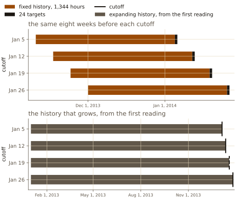
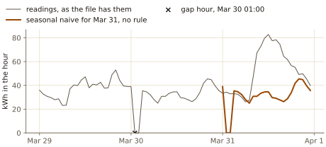

# Backtest without looking ahead

This chapter teaches you to score a day-ahead forecast over a year of cutoffs without letting the future into its history, to handle the two clock-change hours in the data, and to run a shift test that catches a feature which reads past its cutoff. You need what [Chapter 2](#take-the-mase-scale-from-history) gave you: the seasonal naive baseline, MAE, and a scale taken from history. The method stays the same. What changes is how many times you score it, and how carefully you cut the data each time.

## Why one test week misleads {#why-one-test-week-misleads}

So far the evidence is the held-out week of [Chapter 1](#score-on-a-held-out-week): seven day-ahead forecasts for one client, 168 scored hours in all. A sample that size can be lucky. A forecast can match a calm week and miss the next, and one week cannot tell the two apart. Before the supplier trusts a method with each day's purchase, it needs to know how a forecast does across many days, the unusual ones included.

A backtest answers that question with the data you already have. It makes a forecast at many past moments, each with only the readings available at that moment, and scores each one against the readings that followed. Each such moment is a [cutoff](#the-case-and-its-data). Each cutoff, with the hours it forecasts, is a [window](#the-case-and-its-data). The scores of all the windows together say how the method behaves across the year, not on one week.

This matters most for the clock changes. A year of cutoffs contains the March change, when the 01:00 hour does not occur on the clock, and the October change, when one 01:00 label holds two hours of energy. A single week, such as the last week of December, contains neither. A backtest that does not reach those dates cannot show what the method does on them, so the sample has to be chosen with them in mind.

**Working rule:** Prefer a year of cutoffs before you trust a difference between two methods. When cost forces fewer, say so beside each score, as Chapters 4 to 9 do. Make sure the sample reaches the odd days of the year. Report how many windows and how many scored hours stand behind each number. A figure from one week is one sample, and a reader should be able to see that.

## Roll the cutoff forward {#roll-the-cutoff-forward}

A window has three parts: the cutoff, the horizon and the history. The cutoff is the moment the forecast is made. The [horizon](#the-case-and-its-data) is how far ahead it reaches, which is 24 hours here, so the forecast covers the 24 hours that start at the cutoff. The [history](#why-a-baseline-comes-first) is the readings before the cutoff that the model may use, which the book sets at 1,344 hours, or eight weeks. Move the cutoff by a step and you have the next window. The step is one week for the Sunday sample, and one day for the daily samples in the two clock-change subsections, [The March hour that reads zero](#the-march-hour-that-reads-zero) and [The October hour that holds two](#the-october-hour-that-holds-two).

In words, each window's targets are the 24 hours from its cutoff, and its history is the readings from 1,344 hours before the cutoff up to, but not including, the cutoff. The next window moves both by one step. A reading can therefore be a target in one window and history in a later one. That is correct, because by the later cutoff the reading lies in the past, and it is the same reading in both places.

{{fig:rolling-windows}} draws the first four Sunday windows of 2014. The upper panel shows each window's fixed history, {{out:figure-rolling-windows:fixed history hours per window}} hours, as a long bar, with its targets as a short dark bar at the cutoff. The cutoff steps forward {{out:figure-rolling-windows:step between cutoffs, days}} days each time. The lower panel shows the expanding history that `cross_validation` takes when `input_size` is not passed. It starts at the lead client's first reading, {{out:figure-rolling-windows:first reading of the series}}, and at the fourth window it holds {{out:figure-rolling-windows:expanding history hours at the last drawn window}} hours.

[Example: figure-rolling-windows](../examples/figure-rolling-windows.py)

The Sunday sample runs seasonal naive over every Sunday of 2014, from Jan 5 to Dec 28, 2014. The EU puts every clock change on the last Sunday of March and of October ([Directive 2000/84/EC](https://eur-lex.europa.eu/eli/dir/2000/84/oj), Articles 2 and 3), and both changes of 2014, on Mar 30 and Oct 26, are in the sample. The sample uses [`SUBSET8`](#the-case-and-its-data), the book's eight-client subset. Here the year is scored on those eight clients, window by window:

[Example: backtest-sundays-2014](../examples/backtest-sundays-2014.py)

Every window's history holds the same {{out:backtest-sundays-2014:history hours per series, min over windows}} hours for each client, the eight weeks the book specifies, and the example asserts that the length is the same in every window. The {{out:backtest-sundays-2014:windows}} windows score {{out:backtest-sundays-2014:scored hours}} hours: eight clients, 24 hours each, times the windows, less the hours of one late starter before its first reading, which the next paragraphs explain.

The headline is the [mean per-client MASE](#measure-what-each-feature-adds), not the pooled error. The MASE scale is one number per client, and `scoring.book_scale` computes it for the whole book: every reading before the first cutoff, with the clock-change hours masked and each client's leading zeros removed. The first cutoff is Jan 5, 2014, so this sample's scale is read from Jan 1, 2013 to Jan 4, 2014. The mean of the per-client MASE values is {{out:backtest-sundays-2014:mean MASE}}, with the lowest at {{out:backtest-sundays-2014:lowest client MASE}} and the highest at {{out:backtest-sundays-2014:highest client MASE}}, over {{out:backtest-sundays-2014:clients in MASE}} clients.

The [pooled MAE](#measure-what-each-feature-adds), {{out:backtest-sundays-2014:MAE}} kWh over the scored hours, compares methods on the same clients and windows, but it cannot compare clients with each other. Its largest client, {{out:backtest-sundays-2014:largest client by absolute error}}, carries {{out:backtest-sundays-2014:largest client's share of absolute error, percent}} percent of the absolute error, because that client uses thousands of kilowatt hours an hour, so its errors are in the thousands too. The RMSE is {{out:backtest-sundays-2014:RMSE}} kWh.

Client `MT_115` has no reading before Jan 14, 2014. Until then the meter reports zeros, and the data card says those zeros are not demand. The code leaves the {{out:backtest-sundays-2014:scored hours before a first reading}} hours before its first reading out of every score, which are the first two windows. Its history still holds those zeros, because the [start rule](#start-each-series-at-its-first-reading) for histories belongs to Chapter 4. Its MASE is left out for a different reason: its scale is read from the readings before Jan 5, 2014, and it has none. The output lists that client as left out of MASE, and the start rule is left to that chapter.

The statsforecast library has a function for this loop, `cross_validation`, and it is possible to call it without the window you wanted. At version {{version:statsforecast}}, the training slice of each window starts at the first reading of the series unless you pass `input_size`. The history then grows from one window to the next, and the eight-week rule is not in force. [Hyndman and Athanasopoulos](https://otexts.com/fpp3/toolbox.html#sec-accuracy) state the principle that the training set consists only of observations before the test set (*Forecasting: Principles and Practice*, 3rd ed., chapter 5). The code behind `cross_validation` decides the length of that set (statsforecast {{version:statsforecast}}, `statsforecast/core.py`). Its cutoff is the last hour a window trains on, where this chapter's cutoff is the first hour it forecasts, so the two names differ by one hour. This chapter builds each window's history itself, from the cutoff backwards. That gives the same 1,344 hours at every window and makes the rule visible in the code.

**Working rule:** Set the history length explicitly, in hours, and check that it is the same for every window. When a library loops over windows for you, read how it sets the training slice before you trust its output, because its default may be an expanding window rather than the length you chose.

## Keep the future out of the history {#keep-the-future-out-of-history}

A backtest leaks when a window's model sees a reading from the hours it is asked to forecast. The reading can reach the model in several ways: through the history, through a feature, or through a scale computed from data that includes the target. [Hewamalage, Ackermann and Bergmeir](https://arxiv.org/abs/2203.10716) describe rolling-origin evaluation as prone to exactly this, because the test data of one window becomes training data of the next. In forecasting, they note, the leak is easier to make and harder to avoid than in other machine learning tasks (2022, section 3.4).

One rule closes the history path. Each window's history is the readings whose timestamps fall in the eight weeks before its cutoff, and nothing at or after the cutoff. In the book's code, `history_before` keeps the rows with `ds` from the cutoff minus 1,344 hours up to, but not including, the cutoff. The reading at the cutoff itself belongs to the target day, so the same comparison excludes it. Membership is decided by timestamps, not by row positions, so a missing row cannot shift a window by an hour. `history_before` also raises an error unless every client has exactly 1,344 rows in the window.

The window's own first hour is the cutoff, so a cut that is one hour too generous passes the first target reading into the history, and nothing in a forecast shows it. A row count can catch it, and the example below counts the rows.

[Example: history-cut-check](../examples/history-cut-check.py)

Keeping the cutoff hour adds one row, and the count shows it. The history for the cutoff of Dec 29, 2014 runs from {{out:history-cut-check:first history timestamp}} to {{out:history-cut-check:last history timestamp}} and holds {{out:history-cut-check:history rows}} rows. A cut with `ds <= cutoff` holds {{out:history-cut-check:history rows with ds at or before the cutoff}} rows, because the target day's first reading, the cutoff hour, has entered the history. A count one row too high is the sign of that error.

The same care applies to the scale. `evaluate` in `utilsforecast` takes a training frame for its scale, and it cuts that frame by time only when the forecast frame carries a `cutoff` column. Then it keeps the training rows with `ds` at or before the cutoff, which includes the cutoff hour itself (utilsforecast {{version:utilsforecast}}, `evaluation.py`). This chapter does not use that option. Its scale comes from `scoring.book_scale`, which passes only the rows before the first cutoff, and the frame it scores has no `cutoff` column.

**Working rule:** Slice each window's history by its cutoff, never by the start of its test window, and pass a library only the rows it may use. Check the first and last timestamps of every history, and make sure the last one is an hour before the cutoff.

## Meet the clock changes {#meet-the-clock-changes}

The data has two hours that break the simple picture of one reading per clock hour. On the March change day, the local clock goes from 00:59 to 02:00, so the 01:00 hour does not exist on the clock. Mainland Portugal is on Greenwich Mean Time in winter, and the EU moves the clocks at 01:00 Greenwich Mean Time, which is 02:00 local time ([Directive 2000/84/EC](https://eur-lex.europa.eu/eli/dir/2000/84/oj), Article 2). On the October change day, the clock goes back from 02:00 to 01:00, so the 01:00 hour happens twice. The file has one row for 01:00 per day, flagged in the book's data as `clock_change_gap` or `clock_change_repeat`.

The book reads the file under one stated assumption, which every later chapter relies on. A reading's timestamp `ds` is the start of its hour in local clock time, and the index is one naive hourly index with no time zone. The March evidence supports this reading. The dataset's own note, in [Dataset 321 of the UCI Machine Learning Repository](https://doi.org/10.24432/C58C86), says the 01:00 values on the March change day are zero for all clients. The file mostly agrees, as the first subsection shows, and the second shows the two hours in the October label.

### The March hour that reads zero {#the-march-hour-that-reads-zero}

On Mar 30, 2014, the 01:00 label reads zero for {{out:clock-gap-daily-cutoffs:gap hours that read zero}} of the eight clients in the subset. The others read a small amount, not an hour of demand. The census covers all thirty clients.

[Example: clock-change-census](../examples/clock-change-census.py)

Most flagged hours read near zero: {{out:clock-change-census:gap rows below 5 percent of their neighbours}} of the {{out:clock-change-census:gap rows}} flagged client-hours on the two March change days sit below 5 percent of their neighbouring hours, which is what this chapter means by near zero. The median ratio to the neighbours is {{out:clock-change-census:median gap ratio to neighbours}}.

The file mostly agrees with the dataset's note: {{out:clock-change-census:gap rows that read zero}} of the {{out:clock-change-census:gap rows}} read exactly zero, and {{out:clock-change-census:gap rows that read above zero}} read above zero.

The data say zero or near zero, enough for the rule. The meter recorded nothing for an hour that did not occur on the clock, so the reading is not demand.

Seasonal naive copies the last day's values forward, so the forecast for 01:00 on Mar 30 is the demand of Mar 29 at 01:00. That is an ordinary hour, and where the reading is zero, the error is the whole forecast.

{{fig:march-gap-copied}} shows the lead client around the change. Its gap-hour reading is {{out:figure-march-gap-copied:gap hour reading, kWh}} kWh, and the next day's forecast with no rule copies it: at 1am it reads {{out:figure-march-gap-copied:next-day forecast at 1am, no rule, kWh}} kWh, against an actual of {{out:figure-march-gap-copied:actual at next-day 1am, kWh}} kWh.

[Example: figure-march-gap-copied](../examples/figure-march-gap-copied.py)

Make a guess before the next run. The cutoff of Mar 31 looks back over 24 hours, and those hours include the zero. How large is the error at 01:00 on Mar 31 compared with an ordinary hour? The run covers the 15 daily cutoffs from Mar 23 to Apr 6, 2014, first with no rule and then with the rule from the next section:

[Example: clock-gap-daily-cutoffs](../examples/clock-gap-daily-cutoffs.py)

For the median client, the error at 01:00 on Mar 31 is {{out:clock-gap-daily-cutoffs:median client ratio, next-day 1am to other hours, no rule}} times its error at other hours. The forecast for that hour copies the zero for {{out:clock-gap-daily-cutoffs:next-day 1am forecasts that are zero, no rule}} clients.

The gap hour itself fails as well. Its pooled error is {{out:clock-gap-daily-cutoffs:gap-hour MAE with no rule}} kWh, against {{out:clock-gap-daily-cutoffs:other-hour MAE with no rule}} kWh at other hours, and the median client's ratio is {{out:clock-gap-daily-cutoffs:median client ratio, gap hour to other hours, no rule}}. Both pooled figures are set mostly by the largest client, while the per-client median counts each client once.

Pooled, the next day's error at 01:00 is {{out:clock-gap-daily-cutoffs:next-day MAE at 1am with no rule}} kWh, about as much as the gap hour's. The method is wrong on the change hour, and wrong by about as much the day after, because it copied the zero.

**Working rule:** Treat a 01:00 reading of zero on a March clock-change day as a missing hour, not as zero demand. Keep it out of a model's history and out of the scores, and do not let a seasonal method copy it into the next day.

### The October hour that holds two {#the-october-hour-that-holds-two}

On Oct 26, 2014, the 01:00 label holds about two hours of energy. The census puts the median ratio of that hour to its neighbours at {{out:clock-change-census:median repeat ratio to neighbours}}, over the {{out:clock-change-census:repeat rows}} flagged client-hours in the file. The UCI note agrees: the 01:00 values aggregate two hours of consumption.

The failure is the reverse of the March one. On the change day, seasonal naive forecasts the 01:00 label from the day before, which is an ordinary hour, and the actual is about double that. The cutoff of Oct 27 copies the doubled value, so the forecast for 01:00 on Oct 27 is about twice an ordinary hour, and the actual is ordinary.

The same comparison runs over the 15 daily cutoffs from Oct 19 to Nov 2, 2014:

[Example: clock-repeat-daily-cutoffs](../examples/clock-repeat-daily-cutoffs.py)

The pooled figures understate the change-hour failure. On the change hour the forecast is an ordinary hour and the actual is doubled, so the pooled error is {{out:clock-repeat-daily-cutoffs:repeat-hour MAE with no rule}} kWh, against {{out:clock-repeat-daily-cutoffs:other-hour MAE with no rule}} kWh at other hours. The gap looks smaller than it is, because the largest client's errors are large at every hour. For the median client, the change-hour error is {{out:clock-repeat-daily-cutoffs:median client ratio, repeat hour to other hours, no rule}} times its error at other hours.

The doubled value does the most damage the next day. The forecast for 01:00 on Oct 27 copies it, so the pooled error there is {{out:clock-repeat-daily-cutoffs:next-day MAE at 1am with no rule}} kWh, the largest of the three, and the median client's ratio is {{out:clock-repeat-daily-cutoffs:median client ratio, next-day 1am to other hours, no rule}}. A reader who treats the raw October label as an ordinary hour will under-forecast one hour and over-forecast the next.

**Working rule:** Treat the October 01:00 label as two hours of energy in one slot, and never as an ordinary hour. Do not halve it to make it look like one, for the reason the next section gives.

## Mark clock-change hours as missing {#mark-clock-change-hours-as-missing}

The rule the book uses is a choice, and this section states it in one place so that every later chapter can call the same code. Both 01:00 hours, the March gap and the October repeat, are set to missing in the history and in the scores, so a masked hour is never scored. A model that takes missing values skips the hour. A model that cannot, such as seasonal naive, reads a filled value instead, because a missing value would copy into the next day's forecast. Either way the hour is never scored, and the forecast still produces a value for its label, because the output grid must stay complete. The fill is the mean of the hour before and the hour after, taken from the history before the cutoff only. It is a rule of thumb for an hour that sits between two ordinary ones, and it is labelled as one.

Halving the October label instead would give each real hour half of its reading, which assumes both hours used the same energy. The data card does not show that, so the book does not do it.

Without the fill, the forecast for 01:00 on the day after each change is missing for {{out:clock-gap-daily-cutoffs:NaN forecasts without the fill}} of the eight clients in March, and for {{out:clock-repeat-daily-cutoffs:NaN forecasts without the fill}} in October.

With the fill, the next-day error at that hour falls from {{out:clock-gap-daily-cutoffs:next-day MAE at 1am with no rule}} to {{out:clock-gap-daily-cutoffs:next-day MAE at 1am with the rule}} kWh in March, and from {{out:clock-repeat-daily-cutoffs:next-day MAE at 1am with no rule}} to {{out:clock-repeat-daily-cutoffs:next-day MAE at 1am with the rule}} kWh in October, while the error at other hours moves little.

The year of Sunday cutoffs is a different test, because it applies the mask to the scores and the fill plays no part. Scoring the year twice, plain and masked, shows how much the two hours moved the headline.

[Example: clock-masked-backtest](../examples/clock-masked-backtest.py)

The mask takes {{out:clock-masked-backtest:masked hours in scored windows}} masked hours out of the scored windows, the March and October hours of the subset, and the pooled MAE moves only a little, from {{out:clock-masked-backtest:MAE without the mask}} kWh to {{out:clock-masked-backtest:MAE with the mask}} kWh.

The mean MASE goes from {{out:clock-masked-backtest:mean MASE without the mask}} to {{out:clock-masked-backtest:mean MASE with the mask}}, over {{out:clock-masked-backtest:scored hours with the mask}} scored hours rather than {{out:clock-masked-backtest:scored hours without the mask}}. The difference comes from the removed hours.

The Sunday sample cannot show the fill at all, because seasonal naive reads only the day before each cutoff, which is a Saturday for every Sunday cutoff, and no Saturday holds a clock change.

**Working rule:** Mark both clock-change hours missing in every history and every score, count the masked hours in your report, and fill them from the history before the cutoff only when the model cannot take missing values. If the count of masked hours changes from one run to the next, the sample or the file's flags have changed, and you should find out why before you rerun the scores.

## Check a backtest for leakage {#check-a-backtest-for-leakage}

Every window in a backtest should be built from data available at its cutoff, so the check for a leak is simple to state. A feature for a window must have the same value whether it is computed from the history cut at the cutoff or from the whole series. If the two values differ, the feature read a reading after the cutoff, and the backtest flatters the method. The shift test compares a feature computed from the history cut at the cutoff with the same feature computed from the whole series. It is cheap to run, and it catches a mistake that the backtest cannot catch on its own, because a leaking feature scores well by design.

The test has two halves, and each catches what the other misses. Take the lead client, `MT_014`, and three features over its hourly readings. The first is a trailing mean: the average of the 24 hours up to and including each hour, which reads nothing after its hour. The second is the same mean shifted one hour forward, so each value is the average of a window that ends one hour later, and it reads the first hour after the cutoff. The third is a lag of one hour, the most common day-ahead leak. The history half compares each feature on the rows of the eight weeks before each of the three evaluation cutoffs, Dec 29 to Dec 31, 2014. The target half compares the 24 hours that each cutoff forecasts, computed from the readings before the cutoff only. Both versions start from the same first reading, so the warm-up of a rolling mean matches on both sides. Computed from different starts, the warm-up and floating-point rounding would show as false differences, which is why the check compares with a tolerance:

[Example: leakage-shift-check](../examples/leakage-shift-check.py)

On the history rows, the shifted mean differs on {{out:leakage-shift-check:rows differing for the peeking mean}} of the {{out:leakage-shift-check:rows compared}} compared, one at each cutoff: the last hour before each cutoff, whose value depends on the reading at the cutoff itself. The trailing mean differs on {{out:leakage-shift-check:rows differing for the trailing mean}} of them.

The lag of one hour is the case the history half cannot catch. It differs on {{out:leakage-shift-check:rows differing for lag 1}} history rows, because every row it reads lies in the past, so the history half alone passes it.

On the {{out:leakage-shift-check:target hours compared}} target hours it differs on {{out:leakage-shift-check:target hours differing for lag 1}}, since for every target hour after the first, the reading it uses is in the day being forecast. The lag of 24 hours differs on {{out:leakage-shift-check:target hours differing for lag 24}} of them, because it reads the same hour of the day before, which was known at each cutoff.

The shift test checks features and nothing else. It does not check the scale, the fill or the model's own code, which is why the earlier sections set those rules separately. Run it on every feature a model reads, at several cutoffs spread through the year, and include a cutoff on a clock-change day if the feature reads the hour before it.

When a feature fails the test, do not fix the score. Move the feature back until it reads only what was known at its cutoff, then run the test again until the count is zero.

**Working rule:** Keep every lag at least the horizon, 24 hours, so that the reading a lag uses for any target hour was known at the cutoff. Before you trust a backtest with features, run both halves of the shift test on every feature, at several cutoffs spread through the year, and require zero differing rows for every feature the model reads. A feature that differs is reading the future, so fix or remove it before you score anything.

## What goes wrong in production {#what-goes-wrong-ch3}

A backtest is a sample of the past, and the sample is chosen. Every clock change falls on the last Sunday of March or October ([Directive 2000/84/EC](https://eur-lex.europa.eu/eli/dir/2000/84/oj), Articles 2 and 3), so a Sunday sample reaches every change. A sample of Mondays would reach the day after each change without reaching the change hour itself, so the choice of days changes what the backtest can see. Record which dates the sample covers, and rerun the clock check when the sample's dates change.

Calendar effects are a separate sample problem. Easter Sunday, Apr 20, 2014, is a Portuguese holiday, which the `holidays` package lists for Portugal, and the run counts it: {{out:backtest-sundays-2014:Sunday windows on a Portuguese holiday}} of {{out:backtest-sundays-2014:windows}} windows. The held-out week contains Dec 25, 2014, a national holiday in Portugal, and a week of ordinary days and one holiday gives a different score from a week of ordinary days alone. A backtest that uses holiday features must count the holidays in its windows, and say how many fall in the sample.

A pooled error hides the windows that went wrong. A year of windows can average to a respectable number while one month, or one client, carries the error. Break the scores down by month and by client before you report one figure, and look at the worst windows, not only the average.

The masked count follows the calendar flag, not the readings. It changes when the sample's dates or the file's flags change, and it cannot see drift in the readings. Count the masked hours on every run, and alarm on a change in the count, because it is the cheapest signal that the sample or the file has changed. Drift in the readings needs the census: the gap hours that read zero, and the repeat hours against their neighbours. Chapter 10 returns to this in the running log.

Finally, a backtest that passes the shift test can still leak through the scale or the fill, if either is taken from data after the cutoff. The checks in this chapter cover those paths in the examples and the rules, not in every library a reader might use. A reader who adds a library should read how it cuts its training data, as the [default of `cross_validation`](#roll-the-cutoff-forward) shows.

**Working rule:** Run the clock and shift checks again on every data refresh, and before any change to the sample's dates, the history length or the scale. Keep the masked-hour count, the census counts and the shift-test counts in the run log next to the scores, so that a later change in either can be traced to its cause.

## Decisions this chapter made {#decisions-ch3}

- The backtest uses the Sunday cutoffs of 2014. Every clock change falls on a Sunday, so the sample reaches each change, and both of 2014's changes are in it.
- The history of every window is the 1,344 hours before its cutoff, cut by the cutoff, and the length is set in the code, not left to a library default.
- The timestamp `ds` is the start of its hour in local clock time, with no time zone, and the book reads the file under that assumption.
- Both clock-change hours are masked in every history and every score. A model that cannot take missing values reads the mean of the neighbouring hours from history before the cutoff.
- Halving the October hour is rejected, because it assumes the two real hours used the same energy, which the data does not show.
- The headline is the mean per-client MASE, on the one scale of [Chapter 2](#take-the-mase-scale-from-history) through `scoring.book_scale`. Pooled MAE is the second line, with the largest client's share printed.
- Every figure the prose quotes stays bound to a labelled line of its example's output, as [Chapter 1](#decisions-ch1) set out, so a library update changes the chapter's figure and nobody retypes it.
- A client with no reading before the first cutoff is left out of MASE. A late starter's hours before its first reading are left out of every score. Chapter 4 owns the start rule for histories.
- The shift test runs on every feature, both halves. Every lag is at least the horizon, and a feature that differs at any cutoff is not used.
