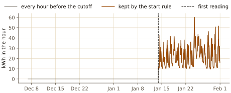
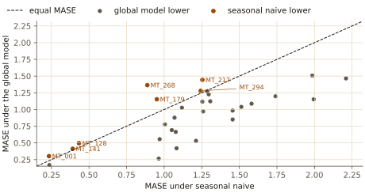

# Forecast many clients with one model

You finish this chapter with one global model for all thirty clients, a start rule that keeps the late starters' leading zeros out of it, and a score that sets it beside seasonal naive for each client on the same cutoffs. The supplier's day-ahead purchase is a total that [Chapter 7](#why-the-total-needs-a-check) builds from thirty client forecasts. A per-client model needs thirty fits for every window, one for each client. The clients share a daily rhythm, so one model fitted on all of them can learn that rhythm once.

[Chapter 5](#measure-what-each-feature-adds) fitted its model on the eight clients of [`SUBSET8`](#the-case-and-its-data). Fitting one model on all thirty raises three choices that decide whether its score can be trusted: whether to give it a client identifier, how to handle the three late starters (clients whose meters begin partway through the data), and how to score thirty forecasts on one scale. Four examples carry the chapter. Each prints its counts first, so you can check that the model covered the clients it should before you read any error.

## One model for many clients {#one-model-for-many-clients}

[Montero-Manso and Hyndman (2021)](https://doi.org/10.1016/j.ijforecast.2021.03.004), in *Principles and algorithms for forecasting groups of time series: Locality and globality*, show that a global model is no more restrictive than a local one, because both can produce the same forecasts. They compare global methods, which fit one model across a group of series, with local methods, which fit each series on its own. A global model fits one set of parameters to many series in a single pass, so every client contributes to what it learns. Their abstract starts from the view that for groups of similar series, global methods outperform the more established local methods, and it notes that later results in that literature show good performance of global models even in heterogeneous datasets. It also reports that global linear models can give competitive accuracy with two orders of magnitude fewer parameters than local methods. The claims in this paragraph come from that abstract. Bojer and Meldgaard (2020) found that global ensemble models and gradient-boosted trees did well in six Kaggle forecasting competitions ([arXiv:2009.07701](https://arxiv.org/abs/2009.07701)). Those are not the supplier's data, so these sources are a reason to try the approach. They are not evidence about this case. The supplier's clients have the same daily shape and different sizes, so the test has to be run on them.

The data is held in long format: one row per client and hour, with three columns. `unique_id` names the client, `ds` is the hour, and `y` is the kilowatt hours used in that hour. Each row carries its own lags, the readings a day and a week earlier. [Chapter 5](#measure-what-each-feature-adds) found that calendar and holiday features did not lower the error on these eight weeks of history, so this chapter uses lags only, at 24 and 168 hours. Both lags are at least the 24-hour horizon, so neither reads the day being forecast.

The lags cost rows. A lag of 168 hours reads a week back, so the first week of each client's history has no row with every lag available. Chapter 5 showed that `MLForecast` drops such rows from training by default. A client's training rows are therefore fewer than the hours in its history. The forecast itself is unaffected, because each forecast hour reads only readings from before its cutoff.

Clients differ in size, and a squared-error loss over raw kilowatt hours lets the largest set the splits, while the small ones carry little weight. So each client's target is scaled before the fit. The scale is `LocalStandardScaler` from mlforecast {{version:mlforecast}}. It gives each client its own mean and standard deviation, and the model learns the scaled values:

`z = (y - mean) / standard deviation`

The mean and deviation come from that client's history before the cutoff only, and the forecasts are converted back with the same two numbers. The library's source shows where this happens. `MLForecast.fit` reaches `TimeSeries._fit` in `mlforecast/core.py`, which fits the scaler on each client's history before the cutoff. That history includes the first week, whose rows the lags then drop from training. `TimeSeries.predict` in the same file inverts the scaling. The class is `_BaseLocalScaler` in `mlforecast/target_transforms.py`. [Chapter 5](#measure-what-each-feature-adds) compared the scaled and unscaled targets on `SUBSET8`, and the unscaled model did worse than seasonal naive. This chapter keeps the scaled target and does not repeat that comparison.

`make_forecaster` in the shared module `examples/lib/features.py` builds one `MLForecast` with one `LGBMRegressor`, set by `LGBM_PARAMS`. The model is deterministic, uses one thread and a fixed seed, and runs under LightGBM {{version:lightgbm}}. The module `examples/lib/panel.py` fits that forecaster once per window, on the panel's history before the window's cutoff. It fills any clock-change hour from that same history, as [Chapter 3](#mark-clock-change-hours-as-missing) does, and returns a forecast for every client.

**Working rule:** Fit one global model when your series share a shape and you must forecast many of them on each window. Scale each series' target with statistics from that window's history only, use only lags at least as long as the horizon, and fit once per window, not once per series. Then score the model per series against a baseline on the same windows, as the sections below do, before you trust its pooled error.

## Identify each client {#identify-each-client}

Once the rows share one table, the model no longer knows which client a row belongs to, unless you tell it. Scaling removes each client's mean and spread, so what remains is mostly the shape of the day. A client identifier puts the client in the table as a static categorical feature. The trees can then split on the client and learn that client's own habits. The cost is one more split to learn for each client, and a client with no history has nothing to learn from. A new client therefore needs a refit before the model can forecast it.

The rule for keeping an identifier is the one [Chapter 5](#measure-what-each-feature-adds) sets for every feature: keep it only if it lowers the mean per-client MASE on decision windows that the standard cutoffs do not use. The held-out week runs from Dec 25 to Dec 31, 2014, and it has seven daily cutoffs. The three standard cutoffs, Dec 29 to Dec 31, 2014, are the reported scores, so the decision does not use them, and it does not use Dec 25 to Dec 28, 2014 either. The [decision windows](#choose-on-decision-windows) are four ordinary days before the held-out week: cutoffs on Nov 25, Nov 26, Dec 2 and Dec 3, all in 2014, each forecasting 24 hours. None of their scored hours falls on a Portuguese holiday. The one holiday of 2014 between these windows and the held-out week, Dec 8, 2014, is not among them. The calendar lists no holiday on Dec 1, 2014.

Before the identifier goes into the model, test it on windows the reported scores never touch. The check fits the model twice on each decision cutoff, with and without the identifier, and refuses to start if a scored hour is a holiday or in the held-out week.

[Example: client-identifier-check](../examples/client-identifier-check.py)

The identifier lowers the mean per-client MASE, from {{out:client-identifier-check:mean MASE plain}} to {{out:client-identifier-check:mean MASE identifier}}, and it lowers the MASE of {{out:client-identifier-check:clients where the identifier lowers MASE}} of the thirty clients.

On these windows the pooled MAE falls too, from {{out:client-identifier-check:MAE plain}} kWh to {{out:client-identifier-check:MAE identifier}} kWh. The two errors weigh clients differently, because the pooled MAE is weighted toward the largest.

The pooled change of {{out:client-identifier-check:pooled MAE change, all clients, kWh}} kWh is almost all from one client, {{out:client-identifier-check:largest client}}, which accounts for {{out:client-identifier-check:pooled MAE change from the largest client, kWh}} kWh of it.

The per-client MASE gives every client the same weight, and the identifier helps across sizes. It lowers the MASE of {{out:client-identifier-check:of the 15 largest clients, where the identifier lowers MASE}} of the fifteen largest clients and of {{out:client-identifier-check:of the 15 smallest clients, where the identifier lowers MASE}} of the fifteen smallest. It does not help only the large clients.

The printed verdict is {{out:client-identifier-check:identifier kept}}, so the identifier is kept and the final model uses it. The margin is small. Other windows could give the opposite sign by a similar small amount, so the verdict is close and depends on the windows. A reader with other windows should measure it again before trusting it.

The identifier has a cost at the standard cutoffs. There, the final model's mean per-client MASE is {{out:global-model-thirty-clients:mean MASE global}} with the identifier, against {{out:global-model-thirty-clients:mean MASE plain}} without it, but its pooled MAE is {{out:global-model-thirty-clients:MAE global}} kWh, against {{out:global-model-thirty-clients:MAE plain}} kWh without it. Chapter 7 has to check its total against that. The rest of the chapter uses the model with the identifier.

**Working rule:** Treat a client identifier as one more feature under [Chapter 5's rule](#measure-what-each-feature-adds): keep it only if it lowers the mean per-client MASE on the decision windows, with the pooled MAE beside it. If the decision is close, say so, and measure it again on other windows. If the identifier wins, write down its cost: a new client has no learned split until it has history, and the model must be refitted before it can forecast that client.

## Apply the start rule to every client {#apply-the-start-rule-to-every-client}

A series begins at its first reading. Before that, the meter reports zeros, and those zeros are not low use. [Chapter 4](#meet-the-late-starters) met this for one client. With thirty clients, three are late starters. `MT_039` first reads on {{out:global-model-raw-starts:first reading MT_039}}, `MT_179` on {{out:global-model-raw-starts:first reading MT_179}}, and `MT_115` on {{out:global-model-raw-starts:first reading MT_115}}. A model fitted on their leading zeros learns a level near zero for them. The [start rule](#start-each-series-at-its-first-reading) drops every reading before a client's first reading. It finds that reading in the rows before the cutoff only.

The rule refuses a cutoff in two cases only: a client has no non-zero reading before the cutoff, or it has fewer than 48 hours of history since its first reading. It does not skip the client, because a skipped client leaves the total short. The rule does not catch a gap or a run of zeros in the middle of a series, and a meter replaced under the same id passes too, because its zeros are not leading. The scale catches a gap, because it refuses a series that is not one unbroken hourly series. Nothing in the forecast checks for one, so a gap there shows only as fewer training rows.

The leak check asks whether the rule reads only the past and refuses the right cutoffs. It runs nine cutoffs, refused or not, and poisons each from the cutoff on, once with zeros and once with a value no meter could record. The history must not change, and every accepted cutoff must hold all thirty clients.

[Example: start-rule-leak-check](../examples/start-rule-leak-check.py)

The real rule passes all three checks. Its refusals match the data's own flag, which uses each first reading and the 48-hour rule: the rule refuses {{out:start-rule-leak-check:cutoffs refused by the start rule}} of the nine cutoffs, the flag predicts {{out:start-rule-leak-check:cutoffs expected to be refused, from the flag}}, and {{out:start-rule-leak-check:cutoffs where the refusal differs from the flag}} cutoffs differ from it.

Poisoning the future changes no history. Its history changes at {{out:start-rule-leak-check:cutoffs whose history changes when the future is poisoned}} cutoffs, and {{out:start-rule-leak-check:accepted cutoffs with a client missing from the history}} accepted cutoffs are missing a client.

The rule removes leading zeros and nothing else. Across the accepted cutoffs it drops {{out:start-rule-leak-check:rows the start rule removes, accepted cutoffs}} rows, and {{out:start-rule-leak-check:removed rows that are not zero}} of them are not zero.

The same checks run on a deliberately broken version, which reads each first reading from the whole series, the leak the checks are written for. It fails each of them. Its refusals differ from the flag at {{out:start-rule-leak-check:broken version, cutoffs where the refusal differs from the flag}} cutoffs, its history changes at {{out:start-rule-leak-check:broken version, cutoffs whose history changes when the future is poisoned}}, and {{out:start-rule-leak-check:broken version, accepted cutoffs with a client missing from the history}} accepted cutoffs drop a client without a message. So a pass on the real rule means something.

The model runs with the start rule and without it, on the standard cutoffs and then the February cutoffs. The counts that differ, and each run's error, show what the rule does.

[Example: global-model-raw-starts](../examples/global-model-raw-starts.py)

At the standard cutoffs the rule matters less than the late starters might suggest. The three standard cutoffs have 8 weeks of history, reaching back to early November, and no client's history in that window holds a zero from before its first reading. So the rule changes no training row there, and {{out:global-model-raw-starts:forecast hours that differ, standard}} of the {{out:global-model-thirty-clients:scored hours}} forecast hours change. The rule still changes the score through the MASE scale.

The February cutoffs, which Chapter 4 used for `MT_115`, are where the zeros enter the history. `MT_115`'s history is {{out:global-model-raw-starts:zero share of history MT_115, 2014-02-01}} percent zeros on Feb 1, 2014, {{out:global-model-raw-starts:zero share of history MT_115, 2014-02-15}} percent on Feb 15 and {{out:global-model-raw-starts:zero share of history MT_115, 2014-02-28}} percent on Feb 28. `MT_179`'s history is {{out:global-model-raw-starts:zero share of history MT_179, 2014-02-01}} percent zeros on Feb 1 and none after.

{{fig:late-starter-history}} draws `MT_115`'s eight weeks before Feb 1, 2014. The meter reads zero until its first reading on {{out:figure-late-starter-history:first reading MT_115}}. The start rule removes the {{out:figure-late-starter-history:rows before the first reading, all zero}} zero rows before it and keeps {{out:figure-late-starter-history:rows the start rule keeps}} rows, of which {{out:figure-late-starter-history:zeros the start rule keeps}} are zero.

[Example: figure-late-starter-history](../examples/figure-late-starter-history.py)

Here the forecasts change, because one model learns from all thirty clients at once: {{out:global-model-raw-starts:forecast hours that differ, february}} of the {{out:global-model-raw-starts:scored hours, february}} forecast hours in these three windows differ. Both runs are scored on the one book scale, read from Feb 1, 2014, so only the histories differ. The mean MASE is {{out:global-model-raw-starts:mean MASE, start, february}} with the rule and {{out:global-model-raw-starts:mean MASE, raw, february}} without it.

Each late starter's MASE moves very little, and the direction is mixed. `MT_039` scores {{out:global-model-raw-starts:MASE MT_039, start, february}} with the rule and {{out:global-model-raw-starts:MASE MT_039, raw, february}} without it, and `MT_115` scores {{out:global-model-raw-starts:MASE MT_115, start, february}} with the rule and {{out:global-model-raw-starts:MASE MT_115, raw, february}} without.

`MT_179` scores {{out:global-model-raw-starts:MASE MT_179, start, february}} with the rule and {{out:global-model-raw-starts:MASE MT_179, raw, february}} without it, the same to two decimals.

The other 27 clients' MAE moves from {{out:global-model-raw-starts:MAE other clients, raw, february}} kWh without the rule to {{out:global-model-raw-starts:MAE other clients, start, february}} kWh with it. The effect is small and mixed, and three windows are too few to call it. We keep the rule because the zeros are not demand, and because the scale depends on it.

You could instead mark the zeros as missing, as the clock rule does for the two clock-change hours in [Chapter 3](#mark-clock-change-hours-as-missing). That would be the wrong fix for this data. A zero before a first reading is the meter being silent, not a reading that is missing, and a missing value would still be a row the model learns from. The start rule removes the rows instead, and its check is simple to state: it removes only rows before the first reading, and every one of them is zero.

**Working rule:** Apply the start rule to every series that has leading zeros, and find each first reading from the rows before the cutoff. When the rule refuses a cutoff, stop the run and name the client and the cutoff. Do not fill the zeros, and do not publish a panel with a client missing. Judge the rule by the scale and by the windows where zeros enter the history, and expect the MAE effect to be small and mixed.

## Score thirty clients on the same cutoffs {#score-thirty-clients-on-the-same-cutoffs}

The three standard cutoffs are Dec 29 to Dec 31, 2014, each at 00:00 on that day, with 24 hours forecast from each. For thirty clients that is 72 scored hours per client. Seasonal naive is the baseline [Chapter 2](#three-baselines-to-beat) set. It takes each cutoff's own history, the 8 weeks before it, and copies the last day's readings forward. At the standard cutoffs no client's history holds a leading zero, so the global model and seasonal naive read the same readings. The comparison is fair because the inputs match, not because the methods are alike.

The headline is the mean per-client MASE, the measure [Chapter 2](#scale-errors-with-mase) defines. The book uses one scale per client per backtest, the rule [Chapter 2](#take-the-mase-scale-from-history) sets, and the function `book_scale` in `examples/lib/scoring.py` builds it. The [scale](#scale-errors-with-mase) is the mean absolute change between each reading and the reading one day earlier, taken over every reading before the first scored cutoff. A late starter is counted from its first reading, and the clock-change readings are masked out. A client with no non-zero reading before the cutoff has no scale, so it is left out of MASE and reported, not treated as an error. Because the scale reads only readings before the scored windows, it is known at every cutoff and cannot leak. Each client counts once in the mean, so one large client cannot set the headline. The pooled MAE and RMSE follow as second lines. They show the error in kilowatt hours that the supplier pays, and they are weighted toward the large clients.

The scale is part of the score. `MT_115`'s scale is {{out:global-model-raw-starts:MASE scale MT_115, counterfactual raw}} kWh if the zeros before its first reading are kept, and {{out:global-model-raw-starts:MASE scale MT_115, start rule}} kWh with the book's rule, which counts it from its first reading.

`MT_039` and `MT_179` move the same way. `MT_039`'s scale rises from {{out:global-model-raw-starts:MASE scale MT_039, counterfactual raw}} to {{out:global-model-raw-starts:MASE scale MT_039, start rule}} kWh, and `MT_179`'s from {{out:global-model-raw-starts:MASE scale MT_179, counterfactual raw}} to {{out:global-model-raw-starts:MASE scale MT_179, start rule}} kWh.

On the standard cutoffs the same forecasts score a mean MASE of {{out:global-model-raw-starts:mean MASE global, counterfactual raw scale, standard cutoffs}} with the scale that keeps the zeros, and {{out:global-model-raw-starts:mean MASE global, book scale, standard cutoffs}} with the book's scale. That difference is the scale, not the model. A score computed with a different scale rule is not comparable with one computed with the book's rule, so every score should record the rule it used.

The score below sets the global model beside seasonal naive on the three standard cutoffs.

[Example: global-model-thirty-clients](../examples/global-model-thirty-clients.py)

The example scores {{out:global-model-thirty-clients:clients scored}} clients on {{out:global-model-thirty-clients:windows}} windows, {{out:global-model-thirty-clients:scored hours}} scored hours, and it counts {{out:global-model-thirty-clients:clients left out of MASE}} clients left out of MASE, which is zero: every client has a non-zero reading before the first cutoff, so every client is in the MASE table.

The count is only as good as its rule. At a cutoff of Dec 15, 2013, {{out:global-model-thirty-clients:clients with no reading before 2013-12-15, check}} clients have no reading yet, and counting any row before the cutoff would give {{out:global-model-thirty-clients:clients with any row before 2013-12-15, broken count}}, which reports no gap.

One global model beats seasonal naive on these cutoffs, for most clients and in total: its mean per-client MASE is {{out:global-model-thirty-clients:mean MASE global}} against {{out:global-model-thirty-clients:mean MASE SeasonalNaive}}, and it wins for {{out:global-model-thirty-clients:clients where global beats seasonal naive}} of the thirty clients. It loses for {{out:global-model-thirty-clients:clients where seasonal naive wins}}, and those clients are the first place to look when the model is refreshed.

{{fig:client-mase-global-vs-naive}} plots each client's MASE under seasonal naive against its MASE under the global model, on the same three cutoffs. The dashed line is where the two are equal, so a client above it is one where seasonal naive wins, and each such client is labelled.

[Example: figure-client-mase-global-vs-naive](../examples/figure-client-mase-global-vs-naive.py)

The pooled figures point the same way. The MAE is {{out:global-model-thirty-clients:MAE global}} kWh against {{out:global-model-thirty-clients:MAE SeasonalNaive}} kWh, and the RMSE is {{out:global-model-thirty-clients:RMSE global}} kWh against {{out:global-model-thirty-clients:RMSE SeasonalNaive}}.

The model without the identifier, printed for reference, has a mean MASE of {{out:global-model-thirty-clients:mean MASE plain}} and an MAE of {{out:global-model-thirty-clients:MAE plain}} kWh, which is the trade-off the [identifier section](#identify-each-client) describes.

The printed figures are means and counts, and a mean can hide one client that is far worse than the rest. When a figure changes, open the per-client table first.

The chapter does not explain why seasonal naive wins for those clients, and that is a reason not to report only the pooled figure. The result covers three windows in one week of one season, so it describes these cutoffs, not every day of the year. The longer test is the seven-window held-out week, which the rolling example in [Chapter 10](#log-every-forecast-before-actuals) uses.

**Working rule:** Score a global model per client on the same cutoffs as the baseline, with the MASE scale fixed before the first scored cutoff. Report the mean per-client MASE beside seasonal naive, and print the counts of clients and scored hours so a reader can check them. State any client left out of MASE and why. Read the pooled MAE and RMSE as the cost in kilowatt hours, not as the measure of model quality.

## Budget the run time {#budget-the-run-time}

A backtest costs fits, and the count is what to check before you run one. A [per-client model](#why-a-statistical-model-comes-next) is fitted once for each client, each window and each method, so the count is clients times windows times methods. Thirty clients over three windows is ninety fits for one per-client method. A global model is fitted once for each window and method, however many clients it covers, so the same three windows cost three fits. More clients make each global fit larger, but they do not add fits.

The book sets a subset rule for the expensive per-client methods. [`SUBSET8`](#the-case-and-its-data) is the eight-client subset that [Chapter 4](#fit-exponential-smoothing) runs its per-client statistical models on. A global model covers all thirty in one fit, so it runs on all thirty clients, as `ALL30`. The subsets are fixed for the whole book, so a number in one chapter can be set beside the next. The window count follows the same logic. Expensive methods use three windows, and cheap methods can use more. Each window of the identifier check costs two global fits, one with the identifier and one without, so its four windows cost eight fits.

The two kinds of cost move differently when the number of clients grows. A per-client method gets more fits, one for each new client. A global model gets bigger fits, because each one reads more rows, and it keeps the same number of fits.

The book does not quote timings. The examples run with one thread, so their output repeats on the machine that recorded the book's outputs, and that choice costs run time. A time depends on the machine, and a reader's machine may differ. Count the fits, not the seconds.

**Working rule:** Before you run a backtest, count its fits: clients times windows times methods for a per-client method, and windows times methods for a global one. If the count is over budget, cut the subset or the window count, never the scored windows, and write the cut down beside the score. Then a reader can compare like with like.

## What goes wrong in production {#what-goes-wrong-ch6}

A run can stop. A client with no non-zero reading before a cutoff, or with under 48 hours of history since its first reading, makes the start rule refuse that cutoff. The rule raises an error instead of skipping the client, because a skipped client leaves the total short, and [Chapter 7](#sum-the-client-forecasts) sums the clients to make the total. In production the run should stop, name the client and the cutoff, and wait for a person. The leak check shows the same refusals in the book's data.

One model moves every client. At the February cutoffs, the late starters' zeros changed {{out:global-model-raw-starts:forecast hours that differ, february}} forecast hours, and the other 27 clients' MAE moved as well, as the [start-rule section](#apply-the-start-rule-to-every-client) shows. Any change to one client's history, to a rule, or to a feature changes forecasts across the panel. After any change, check every client, not only the one you changed.

The scale is part of the score. The same forecasts score a mean MASE of {{out:global-model-raw-starts:mean MASE global, counterfactual raw scale, standard cutoffs}} or {{out:global-model-raw-starts:mean MASE global, book scale, standard cutoffs}}, depending on whether the scale keeps the zeros before a first reading. The [scoring section](#score-thirty-clients-on-the-same-cutoffs) gives the scales. Record the rule with every score, and treat a change to the rule as a change to the score.

The decisions can drift. The identifier decision rests on four ordinary windows that lie outside the held-out week, and its verdict is close. When clients join, leave or change size, the decision should be made again.

A missing client does not appear as an error in the table. A panel of twenty-nine clients is still a valid table, and a forecast of it still looks like a forecast. A run that scores fewer clients or hours than expected, or a count of clients where the global model beats seasonal naive that changes sharply between runs, is a reason to stop. So is a per-client MASE that jumps for one client while the pooled MAE stays flat.

**Working rule:** Print and check the counts (clients, windows, scored hours, refused cutoffs, clients left out of MASE) on every refresh, before any score is read. Then report the mean per-client MASE beside seasonal naive. Stop the run on any refusal, and do not publish a total built from a short panel.

## Decisions this chapter made {#decisions-ch6}

[Chapter 7](#why-the-total-needs-a-check) starts from what this chapter hands over: thirty client forecasts for each standard cutoff, made by one model with the client identifier and the start rule applied, and scored on the book's one MASE scale. The identifier is kept by the decision in `client-identifier-check`, and `examples/lib/panel.py` holds that verdict in `IDENTIFIER_KEPT`. The pooled error at these cutoffs is worse with the identifier, so Chapter 7 should check the total before it relies on the client forecasts.

- One global LightGBM model covers all thirty clients, with lags 24 and 168, no calendar or holiday features, and each client's target scaled from that window's history only, the scaling [Chapter 5](#measure-what-each-feature-adds) settles on.
- A client identifier is kept. The decision used four ordinary windows, from Nov 25 to Dec 3, 2014, outside the held-out week and without a Portuguese holiday, as the book's rule for choosing a setting requires. Mean MASE on those windows moves from {{out:client-identifier-check:mean MASE plain}} to {{out:client-identifier-check:mean MASE identifier}}. The verdict is close, as [the identifier section](#identify-each-client) shows.
- The start rule applies to every client. It refuses a cutoff it cannot start, instead of skipping the client.
- Clock-change hours in each panel history are filled from that history only, so a rolling window across a clock change is fitted, not refused. Chapter 10's rolling windows depend on this.
- The headline is the mean per-client MASE over all thirty clients, on the book's one scale (set in [Chapter 2](#take-the-mase-scale-from-history) and computed by `book_scale`), beside seasonal naive on the same cutoffs. A client with no non-zero reading before the cutoff is left out of MASE and reported. The pooled MAE and RMSE follow as second lines. No client is left out at the standard cutoffs, because each has a reading before the first cutoff.
- The model runs on one thread with a fixed seed, so its output repeats on the machine that recorded the book's outputs. The book has not tested other machines.
