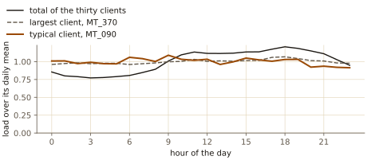

# Make the total add up

You'll forecast the total demand of thirty clients two ways, choose between the two on decision windows, and split that total into client shares using only the history before each cutoff.

The supplier sets its one day-ahead purchase of power against the total demand of its clients, not against any one of them. [Chapter 6](#one-model-for-many-clients) forecast each client, and the total can be built from those forecasts or forecast on its own. This chapter asks whether the two agree, and which one to trust. Both are scored on the same windows as before, so the comparison is fair. The examples use Chapter 6's clients, windows and scale, so each number here is printed by an example you can run.

## Why the total needs a check {#why-the-total-needs-a-check}

Two forecasts of one quantity can disagree, because they are made by different routes. Here the quantity is the total demand of the thirty clients (`ALL30`) in each hour. One route adds up thirty client forecasts. The other fits one model to the total series. Both read the same readings, but each fails in its own way. The sum carries every client's error into the total. The total model sees only the total's own pattern, and the clients' separate patterns can disappear inside it.

The check matters because the supplier buys against the total, not against each client, and a total can miss even when every client is forecast well, if the clients' errors lean the same way in the same hour. The chapter therefore asks two questions, in order. First, do the parts add up to the whole in the data? Second, is a total forecast better than the sum of the parts on the windows that matter?

Forecasts that add up are called coherent. Hyndman and Athanasopoulos's [*Forecasting: Principles and Practice*, 3rd ed., chapter 11](https://otexts.com/fpp3/hierarchical.html) names several ways to make them so, and two matter here. *Bottom-up* forecasts the bottom level, here the clients, and sums the results. *Top-down* forecasts the top, the total, and splits it down by proportions. This chapter uses the two names only in those senses.

Coherence is a constraint, not a measure of accuracy. A total that adds up can still be worse than one that does not. So this chapter scores the total and each client separately, and it never accepts a forecast because its parts agree.

The book builds both totals by hand, in pandas, rather than with `hierarchicalforecast`. The hierarchy has one level, so each route is one sum or one split, and the runtime stays small. A method that combines the two routes optimally does exist. MinT chooses the coherent forecasts that minimise the mean squared error of the coherent forecasts, under an unbiasedness assumption, and it uses the covariance matrix of the forecast errors ([Wickramasuriya, Athanasopoulos and Hyndman, 2019](https://doi.org/10.1080/01621459.2018.1448825); an open working paper is at [robjhyndman.com/papers/mint.pdf](https://robjhyndman.com/papers/mint.pdf)). Estimating that matrix is a project of its own, and this chapter does not take it on.

**Working rule:** Forecast the total both ways whenever a decision depends on it. Score both on the same windows, against the total and against each client. Keep the method that wins on the decision windows, and never accept a total because its parts add up.

## Sum the client forecasts {#sum-the-client-forecasts}

The bottom-up total is the sum, hour by hour, of the thirty client forecasts that [Chapter 6](#one-model-for-many-clients) made. For each cutoff, one global model forecasts every client for the next 24 hours, with lags 24 and 168 and the client identifier that Chapter 6 kept. The total's forecast for an hour is the sum of the thirty values for that hour. With `c` a client and `t` an hour, the rule is `total(t) = sum over c of forecast(c, t)`.

The sum adds up by construction, so the check that matters is on the data. The total series has to equal the sum of the thirty readings in every hour, or every score is measured against the wrong number. The exception is the clock-change hours. A clock-change flag sets a client's reading to missing, so the total is missing at 01:00 on Mar 31, 2013 and Mar 30, 2014, the gap hours, and at 01:00 on Oct 27, 2013 and Oct 26, 2014, the repeat hours.

Every score below is measured against the total, so the total has to match its parts first. The first example builds both totals and scores them, and its last lines check that match in each clock-free hour.

[Example: total-bottom-up-and-direct](../examples/total-bottom-up-and-direct.py)

In every hour without a clock-change flag, the total equals the sum of the thirty clients. The check counts {{out:total-bottom-up-and-direct:clock-free hours where the total differs from the sum of the thirty clients}} hours that differ.

The clock-change hours need one more rule. The total is missing in those hours, but the forecast is not. Each forecast window still produces a value for every labelled hour, so the output grid has no holes that a downstream table would have to fill. The scoring refuses a forecast hour that has no reading, so a masked hour cannot be scored as a zero. No scored window in this chapter holds one.

The start rule applies to each client before the sum. A late starter's zeros before its first reading are not demand, so the rule drops them, as [Chapter 4](#meet-the-late-starters) showed for one client. The rule does not change the total, because a zero adds nothing to a sum, and a client that has not started contributes nothing either. The check above shows it. The rule does change each client's own forecast, because a model fitted on those zeros would learn them as low use.

The bottom-up total inherits the clients' errors, good and bad. Chapter 6 found that the model beats seasonal naive for {{out:global-model-thirty-clients:clients where global beats seasonal naive}} of the thirty clients on the standard cutoffs, and does worse for the rest. The comparison later in the chapter measures how much of that error reaches the total.

Only means add. The mean of a sum is the sum of the means, because expectation is linear. The median of a sum is not, in general, the sum of the medians, and the same holds for other quantiles. They add only in special cases, such as errors that move together perfectly. So the bottom-up total is a point forecast. A range for the total cannot be built by adding the clients' ranges. Chapter 8 returns to this for the intervals.

**Working rule:** Sum the client forecasts hour by hour, after checking that the total series equals the sum of its readings in every hour without a clock-change flag. Apply the start rule to each client before the sum, so no client's model is fitted to its zeros. Treat the sum as a point forecast, and do not take the sum of the clients' medians as the median of the total.

## Forecast the total directly {#forecast-the-total-directly}

The direct total is one model fitted to the total series itself. Its history is the total's history before the cutoff: the readings of the 1,344 hours before it, which is 8 weeks, the same length as the clients' histories. Each client's history is cut by the start rule, its clock-change hours are filled from its own neighbours, as [Chapter 3](#mark-clock-change-hours-as-missing) does, and the readings are summed by hour. The total's history therefore has no missing hour.

The model uses the features the clients use. Its inputs are the total's readings 24 and 168 hours earlier, so no input comes from the day being forecast. Its target is the total as it is, not scaled. [Chapter 6](#score-thirty-clients-on-the-same-cutoffs) scales each client's target, because one model over clients of different sizes would otherwise fit the large ones. A single total has no such mix, so that reason does not carry over. On the decision windows, the unscaled target has the lower error, {{out:total-bottom-up-and-direct:MAE direct, decision windows}} kWh against {{out:total-bottom-up-and-direct:MAE direct with a scaled target, decision windows}} kWh with the target scaled, as [the first example](../examples/total-bottom-up-and-direct.py) shows, so the direct model uses it. The model is fitted once per cutoff, on that cutoff's history only, and it forecasts the next 24 hours. It is a LightGBM regressor inside mlforecast {{version:mlforecast}}, with the settings of [Chapter 5](#measure-what-each-feature-adds).

The two totals differ in how they are built. The bottom-up total comes from one global model that forecasts every client, and the direct total from one model that forecasts the sum. The lags and the other settings are the same. The target scaling differs, and the decision windows choose it for the direct model alone.

The total is usually smoother than any client, because the clients' peaks partly cancel in the sum. A model fitted to a smoother series has less of its own noise to learn, which can help the direct total. The comparison later in the chapter tests whether it does on these windows, and the answer is not the one the smoothness suggests.

The model sees the total only through its history. It does not see which client a reading came from, or which client moved the total. That is the trade the direct method makes. It gets one smooth series and loses the clients' separate shapes. The bottom-up method keeps those shapes and must add thirty errors together.

Seasonal naive on the total is the baseline that both must beat. It forecasts each hour as the same hour the day before, as in [Chapter 2](#three-baselines-to-beat), applied to the total's history. It is scored on the same windows and against the same scale.

**Working rule:** Forecast the total directly with the clients' features, from the total's own history before each cutoff, and choose the target's scaling on the decision windows. Use the same windows for both methods, and score each against seasonal naive on the total. Report both methods, and not only the one you built.

## Compare the two totals {#compare-the-two-totals}

On the four decision windows, the [bottom-up total](#sum-the-client-forecasts) has the lower error, so it is the method chosen. Those windows are [Chapter 5's](#choose-on-decision-windows) four ordinary days before the held-out week, used only to choose: Nov 25, Nov 26, Dec 2 and Dec 3, 2014. [Chapter 6](#identify-each-client) chose the client identifier on the same days. Each method is scored by MAE on the total, and bottom-up's MAE there is {{out:total-bottom-up-and-direct:MAE bottom-up, decision windows}} kWh, against {{out:total-bottom-up-and-direct:MAE direct, decision windows}} kWh for the [direct total](#forecast-the-total-directly). The example refuses to run if a decision hour falls on a Portuguese holiday, and it counts {{out:total-bottom-up-and-direct:decision holiday hours}} such hours.

The standard cutoffs, Dec 29 to Dec 31, 2014, are the report. They are not used to choose. On these three windows the total has {{out:total-bottom-up-and-direct:scored hours}} scored hours. Its [MASE scale](#scale-errors-with-mase) is the mean absolute change between readings a day apart, taken over every reading before Dec 29, 2014, with the clock-change hours masked. That is the rule for a MASE scale from [Chapter 2](#take-the-mase-scale-from-history), as [Chapter 6](#score-thirty-clients-on-the-same-cutoffs) applies it to each client, here applied to the total, and it comes to {{out:total-bottom-up-and-direct:MASE scale of the total}} kWh.

| Method | MAE (kWh) | MASE |
| --- | --- | --- |
| Seasonal naive | {{out:total-bottom-up-and-direct:MAE SeasonalNaive}} | {{out:total-bottom-up-and-direct:MASE SeasonalNaive}} |
| Bottom-up | {{out:total-bottom-up-and-direct:MAE bottom-up}} | {{out:total-bottom-up-and-direct:MASE bottom-up}} |
| Direct | {{out:total-bottom-up-and-direct:MAE direct}} | {{out:total-bottom-up-and-direct:MASE direct}} |

MAE and MASE rank the methods alike here. MAE is in kilowatt hours, so it reads as the average cost of an hour's error. [MASE](#scale-errors-with-mase) divides each error by the same scale, so on one series it is only a constant multiple of MAE. Its use is across series. [Chapter 6](#score-thirty-clients-on-the-same-cutoffs) needs it to compare clients of very different sizes, and the total sits beside them on the same footing.

On the standard cutoffs the direct total beats seasonal naive on the total, but by a smaller margin than the bottom-up total does, as the MASE column of the table shows.

A method wins on the decision windows when its error is lower there, and the standard cutoffs then either confirm that or contradict it. For the total, the standard cutoffs confirm the choice, since bottom-up is lower on both window sets. That agreement is why the chapter recommends bottom-up for the total, with some confidence. Agreement counts only when the two sets are separate, and they are. The four decision windows all fall before Dec 25, 2014, the first day of the held-out week, and the standard cutoffs are the last three days of that week. No decision reads a standard cutoff.

The identifier is where the two window sets disagree. On the decision windows, the bottom-up total without the identifier has an MAE of {{out:total-bottom-up-and-direct:MAE bottom-up without identifier, decision windows}} kWh, against {{out:total-bottom-up-and-direct:MAE bottom-up, decision windows}} kWh with it, so the identifier lowers the total's error there, as the per-client MASE in [Chapter 6](#identify-each-client) does on the same windows. On the standard cutoffs the plain total has an MAE of {{out:total-bottom-up-and-direct:MAE bottom-up without identifier}} kWh, and the total with the identifier has {{out:total-bottom-up-and-direct:MAE bottom-up}} kWh. The standard cutoffs therefore favour the plain total. The book reports that and does not act on it, because Chapter 6 kept the identifier on per-client MASE, and the decision windows are the ones that choose. A supplier that doubts four decision windows should add decision windows before Dec 25, 2014, and decide again on those, not on the standard cutoffs.

**Working rule:** Choose a method on the decision windows, by the measure you will report. Report the same measure on the standard cutoffs beside seasonal naive, with the scored hours and the scale. When two window sets disagree, report both, say how far apart they are, and do not pick the one that reads better.

## Split a total by share {#split-a-total-by-share}

The top-down split starts from the [direct total](#forecast-the-total-directly) and gives each client a share of it. A client's share is its readings summed over its own history, the 1,344 hours before the cutoff, divided by the total's readings summed over the same hours. Each client's top-down forecast for an hour is the direct total's forecast for that hour, times its share. A client that supplied a tenth of the total over the past 8 weeks is expected to take a tenth of the total the next day.

The eight weeks are a choice, not a tuned value. They are the history every other model in this chapter reads, so the split uses the same memory as the clients. A shorter window would follow a change in a client's share sooner, and it would be noisier. This chapter does not measure that trade-off. A supplier that wants it should test it on the decision windows.

The split's weak point is the shape of the day. It gives every client the total's daily profile, so a client that peaks at a different hour gets the wrong profile in every hour, however good the total forecast is. On these clients the split loses even with the true total in hand. A check this chapter calls the oracle check applies the shares to the actual total, which no forecast can know, and its mean per-client MAE is {{out:total-split-by-share:mean per-client MAE with the true total split by share}} kWh. That is a reference, not a method: the error the split would have with a perfect total. The bottom-up forecast, which has to forecast each client, has a mean per-client MAE of {{out:total-split-by-share:mean per-client MAE bottom-up}} kWh.

{{fig:client-daily-profiles}} draws the average day of the total, the largest client and a typical client, each divided by its own daily mean, over the eight weeks before the first standard cutoff. {{out:figure-client-daily-profiles:clients whose average day peaks at a different hour from the total's}} of the thirty peak at another hour from the total's, and the typical client is the middle one of those by gap. The largest client, {{out:total-split-by-share:largest client share of the total, first cutoff}} of the total, differs from the total's day by {{out:figure-client-daily-profiles:mean absolute difference from the total's day, largest client}} on average, against a median of {{out:figure-client-daily-profiles:median gap across the thirty clients}} across the thirty.

[Example: figure-client-daily-profiles](../examples/figure-client-daily-profiles.py)

At night the shapes part. Averaged over midnight to 05:00, the total's day is {{out:figure-client-daily-profiles:night mean of the total's average day, hours 0 to 5, over its mean}} of its mean, while the largest client's is {{out:figure-client-daily-profiles:night mean of the largest client's average day, hours 0 to 5, over its mean}} of its own and the typical client's {{out:figure-client-daily-profiles:night mean of the typical client's average day, hours 0 to 5, over its mean}}. A split by share hands both clients the total's night dip, which neither of them has.

The shares are also uneven. On the first cutoff, Dec 29, 2014, the largest client's share of the total is {{out:total-split-by-share:largest client share of the total, first cutoff}}.

The working paper that defines MinT reports, citing Hyndman et al. (2011), that a top-down split biases the reconciled forecasts at each level, even when the base forecasts are unbiased ([Wickramasuriya, Athanasopoulos and Hyndman, 2017](https://robjhyndman.com/papers/mint.pdf)). This chapter does not re-derive that result. It measures the split on these clients, and the oracle check gives a reference for the split's own error.

Scoring the split client by client, against bottom-up on the same windows, shows whether it wins for any single client, which a mean cannot show. The second example does that, and runs the leak check on the shares. It makes the choice on the decision windows first, then reports the standard cutoffs.

[Example: total-split-by-share](../examples/total-split-by-share.py)

On the decision windows bottom-up wins for the clients, with a mean per-client MASE of {{out:total-split-by-share:mean per-client MASE bottom-up, decision windows}} against {{out:total-split-by-share:mean per-client MASE top-down, decision windows}} for top-down, so bottom-up is chosen.

On the standard cutoffs the split is worse on error in kilowatt hours as well. Over {{out:total-split-by-share:scored hours}} client hours, its mean per-client MAE is {{out:total-split-by-share:mean per-client MAE top-down}} kWh, against {{out:total-split-by-share:mean per-client MAE bottom-up}} kWh for bottom-up, and top-down has the lower MAE for {{out:total-split-by-share:clients where top-down has the lower MAE}} of the thirty clients.

The mean per-client MASE is {{out:total-split-by-share:mean per-client MASE top-down}} for top-down, against {{out:total-split-by-share:mean per-client MASE bottom-up}} for bottom-up. Chapter 6's pooled MAE for the same forecasts is {{out:global-model-thirty-clients:MAE global}} kWh, the same as the bottom-up mean of {{out:total-split-by-share:mean per-client MAE bottom-up}} kWh. That is no accident, because every client has the same 72 scored hours, so the mean of the client errors equals the pooled error.

No share moves. A share must read only the history before its cutoff, so the leak check changes every reading from each cutoff on, once to zero and once to a very large value, and recomputes the shares. Across the six comparisons (three cutoffs by two values), {{out:total-split-by-share:shares changed after poisoning readings from their cutoff}} of them change a share. If any share had read a reading after its cutoff, the large value would have entered it. The shares add to 1, and the top-down clients add up to the direct total in every hour, by construction. An identity like that cannot fail, so the chapter counts only the leak check, the one test here that can.

**Working rule:** Split a total by share only as a baseline, or when the clients' daily profiles are alike. Compute each share from the history before its cutoff, check that no share moves when readings after its cutoff change, and score each client against bottom-up on the same scale. Keep the split for a client only when it wins on the decision windows.

## What goes wrong in production {#what-goes-wrong-ch7}

Most failures in this chapter are silent.

The first is a quietly short total. If one client drops out of the sum, the total is smaller than the demand, and its scores still look reasonable. The bottom-up total in this book raises an error when an hour has fewer than thirty client forecasts. The start rule refuses a client with too little history instead of skipping it, as [Chapter 6](#apply-the-start-rule-to-every-client) explains. In production, a run that builds fewer forecasts than clients should stop and name the missing client.

The second is the raw sum. The October repeat hour holds the energy of two ([Chapter 3](#the-october-hour-that-holds-two)), so a total built from raw readings can count that hour at roughly twice its neighbours. The result is a demand spike that is not there. The book's total masks the hour instead, and the check in [the first example](../examples/total-bottom-up-and-direct.py) excludes the clock-change hours for the same reason.

The third is a split that reads the future. A split whose shares use the window's own readings scores better in a backtest than it will in production. The [poisoning check](#what-goes-wrong-ch10) is the test. A share must not move when readings after its cutoff change. A production run should keep both checks, the share check in [the second example](../examples/total-split-by-share.py) and the scale check in [the first](../examples/total-bottom-up-and-direct.py), as tests that fail loudly.

The fourth is a decision and a report that disagree. The identifier lowers the total's error on the decision windows and raises it on the standard cutoffs. A monitor that watches only one set of windows will miss the other's failure. On every refit, log the total's error with and without the identifier on the same windows, beside the per-client MASE that [Chapter 6](#identify-each-client) uses to decide.

The fifth is a share that goes stale. A share is a fact about the past 8 weeks, so when a client's habits change, its share lags the change for as long as the window is long. A top-down forecast of that client is then wrong in a steady direction, not at random, and the error does not show in the total at all, because the shares still add to one. A monitor should therefore watch each client's share over time, not only the total's error. The per-client MASE in [the second example](../examples/total-split-by-share.py) is the measure that sees it.

The sixth is a scale that moves with the window. The total's MASE scale is read once, from the history before the first scored cutoff. A scale refreshed for each window reads that window's own readings, and every score on the total then changes for reasons that have nothing to do with the forecast. [The first example](../examples/total-bottom-up-and-direct.py) checks, for each scored cutoff, that the scale for that window does not move when readings from the cutoff on are replaced. No scale moves: {{out:total-bottom-up-and-direct:scale changes after poisoning readings from each scored cutoff}} of the six comparisons (three cutoffs by two values) changes it.

**Working rule:** In production, check the total against the sum of its readings on every refit, stop when a client is missing from a total, and run the poisoning check on each share and on the scale for each window. Log the total's error with and without the identifier on the same windows. When the windows disagree, report both and do not choose the one that flatters the model.

## Decisions this chapter made {#decisions-ch7}

- **The total is the hourly sum of `ALL30`.** Each client is cut by the start rule before the sum, and an hour is missing when any client's reading in it is masked as a clock-change hour. The sum does not change with the start rule, and the check in the first example shows it.
- **Every forecast hour has a value, and scoring refuses a masked hour.** The output grid is complete through the clock-change hours, and a missing reading is never scored as zero.
- **Both totals are built by hand, in pandas.** The hierarchy has one level, so each route is one sum or one split. `hierarchicalforecast` and MinT are named, and neither is used.
- **The total is forecast bottom-up.** It has the lower MAE on the four decision windows and on the standard cutoffs. The direct total is reported beside it.
- **The direct total's target is unscaled.** On the decision windows it has the lower MAE, so the direct model does not scale its target, unlike the clients' model. The first example prints both settings.
- **The identifier stays in the bottom-up total, as [Chapter 6](#identify-each-client) decided for the clients.** Its cost to the total on the standard cutoffs is reported above, not reversed.
- **The split is not the client method.** Bottom-up has the lower per-client MASE on the decision windows, and on these clients the split loses even with the true total.
- **Shares come from the 1,344 hours before each cutoff, the same history as the clients.** The poisoning check shows that no share reads a later reading.
- **The total's MASE scale is the rule from Chapter 2, applied to the total:** the seasonal naive error over every reading before the first scored cutoff, with clock-change hours masked and the start rule applied to each client first.
- **The windows are Chapter 6's.** The decision windows and the standard cutoffs are the same days, so the two chapters' numbers can be compared line by line.
- **Chapter 8 receives point forecasts:** the bottom-up forecast for each client and for the total, with the direct total as the alternative. A range for the total cannot be built from the clients' ranges.
